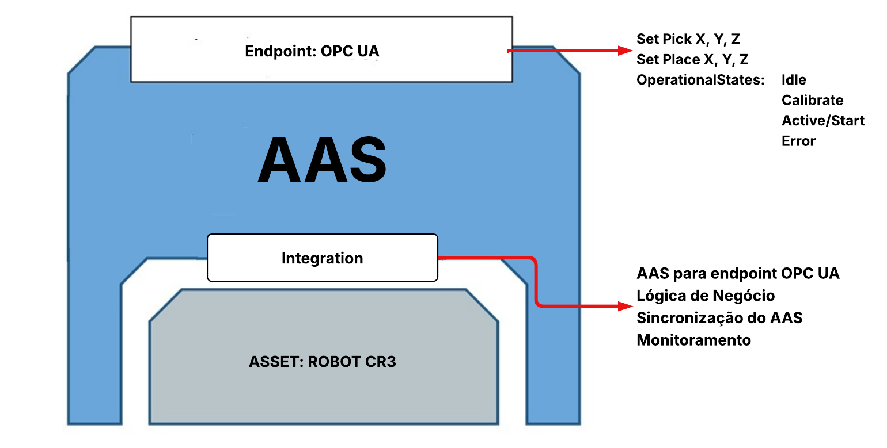

# Robô CR3 para atividade de Pick and Place com AAS, OPC UA e Modbus

Este documento detalha a arquitetura, funcionamento e uso do projeto de controle para um robô de Pick and Place, utilizando uma abordagem baseada em Gêmeo Digital através de um Asset Administration Shell (AAS).

---

## 1. Visão Geral da Arquitetura

O sistema implementa um **Gêmeo Digital** de um robô manipulador (neste caso, um **Dobot CR3**) para orquestrar operações de pick and place. 




- A comunicação com o mundo externo é padronizada através de um endpoint **OPC UA**.  
- A comunicação com o hardware real (ou simulador) do robô é feita via **Modbus TCP**.  

O coração do sistema é a **camada de integração**, que traduz os comandos de alto nível recebidos pelo OPC UA em comandos de baixo nível para o controlador do robô via Modbus.

A arquitetura consiste em:

- **ASSET (ROBOT CR3):** O equipamento físico ou seu simulador, que responde a comandos Modbus.  
- **AAS (Asset Administration Shell):** A representação digital do robô. Ele encapsula toda a informação, dados e funcionalidades do ativo em um formato padronizado.  
- **Endpoint OPC UA:** A interface de comunicação do AAS. Clientes externos (MES, SCADA ou clientes de teste) se conectam a este endpoint para monitorar e controlar o robô.  
- **Camada de Integração:** Código Python deste projeto que sincroniza o estado do AAS com o robô real e gerencia a comunicação entre os protocolos.  

---

## 2. Estrutura dos Arquivos

Principais arquivos do projeto:

- **`docker-compose.yaml`**
  - Orquestra a execução da aplicação em um contêiner Docker.  
  - Mapeia a porta OPC UA (`4840` do contêiner para `4892` do host).  
  - Configura variáveis de ambiente `MODBUS_HOST` e `MODBUS_PORT` para definir o endereço do robô/simulador.  

- **`pick_and_place.py`**
  - **Arquivo central da lógica de negócio.**
  - Implementa o submodelo `PickAndPlace` do AAS.  
  - Inicializa o cliente Modbus para comunicação com o robô.  
  - Inscreve-se na variável `OperationalState` do servidor OPC UA para aguardar comandos.  
  - Contém a função `opcua_callback`, acionada quando um novo comando é recebido.  

- **`modbus_comm_manager.py`**
  - Classe utilitária que abstrai a comunicação Modbus.  
  - Usa a biblioteca `pymodbus` para operações de leitura e escrita.  

- **`opcua_tools.py`**
  - Funções utilitárias para interação com o servidor OPC UA (`asyncua`).  
  - Inclui funções para encontrar nós na árvore do servidor e manipular notificações.  

- **`user_entrypoint.py`**
  - Ponto de entrada que inicializa a aplicação.  
  - Torna os nós OPC UA relevantes **writable**, permitindo modificações por clientes externos.  

- **`requirements.txt`**
  - Lista todas as dependências Python necessárias, como `asyncua` e `pymodbus`.  

---

## 3. Como Usar

### Pré-requisitos

1. **Docker e Docker Compose** instalados.  
2. Um **simulador de robô ou robô real** acessível via Modbus TCP.  

### Configuração

1. Ajuste o arquivo `docker-compose.yaml` para definir o endereço do robô/simulador:  

```yaml
environment:
  MODBUS_HOST: "192.168.0.190"  # <-- ALTERE ESTE IP
  MODBUS_PORT: "502"            # <-- ALTERE ESTA 

```


### 4. Fluxo de Operação

O controle do robô é realizado inteiramente via servidor OPC UA.

**Ferramenta recomendada:** [UaExpert](https://www.unified-automation.com/products/development-tools/uaexpert.html) ou outro cliente OPC UA.

### Passo a Passo para um Ciclo

**1. Conectar ao Servidor OPC UA**

Conecte o cliente OPC UA em `opc.tcp://localhost:4892` (se estiver na mesma máquina).

**2. Definir Coordenadas**

Navegue na árvore OPC UA até os seguintes nós de pick e de place e defina:
 Pick:
- `XPosition`
- `YPosition`
- `ZPosition`


 Place:
- `XPosition`
- `YPosition`
- `ZPosition`

**3. Iniciar o Ciclo**

Acesse o nó de operações:


Escreva `"start"` ou `"active"` no campo `Value`.

---

### O que Acontece (`opcua_callback` em ação)

1. A aplicação detecta a mudança no nó `OperationalState`.
2. **Validação:** Coordenadas de Pick/Place são lidas e verificadas contra limites (`MaxLimit`/`MinLimit`) do AAS.
   - Se inválidas → Estado muda para `Error`.
3. **Fase 1:** Move para posição de Pick via Modbus (aguarda `SIMULATED_MOVE_TIME`).
4. **Fase 2:** Move para posição de Place.
5. **Fase 3:** Retorna à posição Home.
6. **Finalização:** `OperationalState` volta para `Idle`, pronto para novo comando.

---

### Outros Comandos

- **Calibrar / Retornar à Home:**  
  Escreva `"calibrate"` no nó `OperationalState` para retornar apenas à posição Home.

- **Erro:**  
  Se ocorrer falha de comunicação ou coordenadas inválidas → `OperationalState = Error`.

---

## 4.1 Modo gateway MQTT → Modbus (contrato Hermes)

Neste modo a camada roda **fora** do servidor AAS. O servidor AAS (o mesmo do Robô Educacional,
com a ponte `educational-robot-aas/src`) publica o comando em
`spacexlab/AAS/<ASSET_ID>/command`. O gateway executa no CR3 por Modbus e devolve
`{"operational_state": "Idle"}` (ou `"Error: ..."`) em `spacexlab/AAS/<ASSET_ID>/state`. Só esta
camada muda entre o Robô Educacional e o CR3, e é isso que sustenta o teste de troca.

```bash
cd integration-layer
python -m src.gateway_mqtt
```

Variáveis: `MQTT_HOST` (localhost), `MQTT_PORT` (1883), `ASSET_ID` (dobot_cr3), `MODBUS_HOST`
(localhost), `MODBUS_PORT` (5020), `AAS_OPCUA_URL` (opc.tcp://127.0.0.1:4886), `MOVE_TIME` (1 s),
`MODBUS_REG_STATUS` (vazio ou 0 = tempo fixo; 4009 = handshake) e `MOVE_TIMEOUT` (30 s).
Os limites (`CoordinateLimits`) e a `HomePosition` são lidos da AAS por OPC UA a cada comando.

### Máquina de estados (Fase 4.3)

O estado do gateway vai para o `OperationalState` da AAS a cada transição (mensagem MQTT retida
em `.../state`).

| Estado | OperationalState | Significado |
| --- | --- | --- |
| Ocioso | `Idle` | pronto para Start ou Calibrate |
| Executando | `Executing` | ciclo ou retorno à home em andamento |
| Parado | `Stopped` | parada pedida (Stop) ou informada pelo robô; robô parado |
| Erro | `Error: <código>` | falha; robô parado (OP_MODE = 0) até um Calibrate |

| De | Evento | Para |
| --- | --- | --- |
| Idle | Start válido | Executing → Idle ao terminar |
| Idle | Start inválido (coordenada ou home fora da área) | Idle, com `Error: <código>` na AAS (recusa: o robô não se moveu) |
| Idle | Calibrate | Executing → Idle |
| Idle | Stop | Stopped |
| Idle | conexão Modbus perdida, alarme ou parada do robô (vigilância a cada 1 s) | Error ou Stopped |
| Executing | Stop, ou robô informa parada | Stopped |
| Executing | falha de comunicação, alarme ou movimento sem fim (`MOVE_TIMEOUT`) | Error |
| Executing | Start ou Calibrate | Executing (ignorado: ocupado) |
| Stopped ou Error | Calibrate | Executing → Idle (reconecta, relê a AAS e vai à home) |
| Stopped ou Error | Start | recusado: é preciso Calibrate antes |

Códigos de erro: `Coordinates Out of Bounds`, `Home Position Out of Bounds`, `Invalid Command`,
`Calibration Failed`, `AAS Not Reachable`, `Modbus Not Connected`,
`Modbus Communication Failed`, `Robot Alarm` e `Motion Timeout`.

O comando `Stop` sai do OperationalState da AAS: a ponte `educational-robot-aas/src` passou a
repassar `{"data": {"cmd": "stop"}}`, além de start e calibrate.

### Fim do movimento: proposta de handshake com o controlador

Com `MODBUS_REG_STATUS=4009`, o gateway deixa de esperar um tempo fixo e passa a ler o
registrador de status. **O programa do controlador do CR3 precisa implementar este handshake**
(o simulador já implementa, com `SIM_EMULA_STATUS=1`):

| Valor em 4009 | Quem escreve | Significado |
| --- | --- | --- |
| 1 | gateway | movimento disparado (junto com os registradores de destino) |
| 0 | controlador | movimento concluído, robô pronto |
| 2 | controlador | alarme ou colisão → `Error: Robot Alarm` |
| 3 | controlador | pausa, botão de parada ou emergência → `Stopped` |

Enquanto o programa do controlador não tiver o handshake, use `MODBUS_REG_STATUS=0` (tempo fixo).
Nesse modo, uma parada feita no próprio robô não é detectada. Para ensaiar as falhas no
simulador: `servidor-local/testes/falha_cr3.py --parada | --alarme | --pronto`.

- `cr3_motion.py` reúne o mapa de registradores 4000–4008, as validações (caixa + cúpula) e a
  sequência de escrita. Os dois modos usam o mesmo código.
- Para rodar tudo na própria máquina, sem o `aas_core` e sem o hub (servidor OPC UA local,
  Mosquitto e simulador), veja `../servidor-local/README.md`.

Correções feitas junto com o modo gateway:
- `modbus_comm_manager.py` usa a API do pymodbus 3.x (`pymodbus.client`, `slave=`); versão fixada
  em `pymodbus==3.8.6`.
- `monitorarModbus.py`: o bloco ganhou 1 registrador porque o pymodbus 3.x soma 1 ao endereço.
  Sem isso a escrita em 4008 (PLACE_Z) era recusada.
- `pick_and_place.py`: ao voltar para a home, as posições são reescritas no tipo do nó (String na
  AAS do CR3). Antes, um float dava `BadTypeMismatch` e o `calibrate` sempre falhava.
- Falha de escrita Modbus agora vira `Error` em vez de terminar em `Idle`.

---

## 5. Tecnologias Utilizadas

- Docker/Docker Compose para deploy
- `asyncua` para servidor OPC UA
- `pymodbus` para comunicação Modbus TCP
- Python 3.10+ como linguagem principal

---

## 6. Licença

Este projeto é de uso **acadêmico/experimental**. Ajuste conforme sua necessidade.

**Autor:** Flavio Santos / Equipe: Space X  
**Contato:** flaviosantos.engsoft@gmail.com

